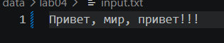
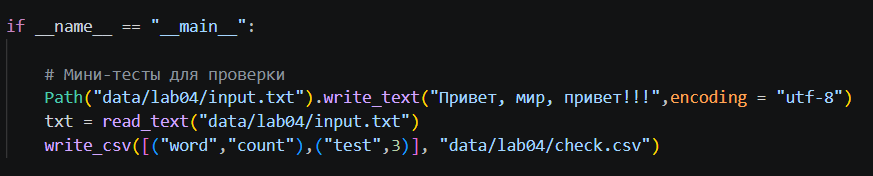
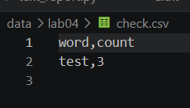
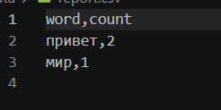
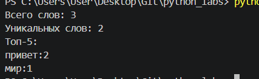
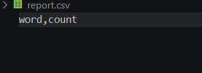
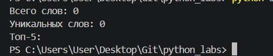
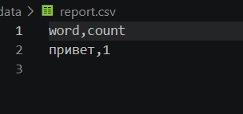
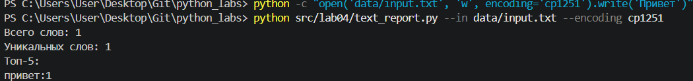

# ЛР4 — Файлы: TXT/CSV и отчёты по текстовой статистике
---
## Задание A — модуль src/lab04/io_txt_csv.py


```python
def ensure_parent_dir(path: str | Path) -> None:
    """
    Создает родительские директории для указанного пути, если они не существуют.
    
    #:param path: Путь к файлу, для которого нужно создать директории.
    """

    p=Path(path)
    p.parent.mkdir(parents=True, exist_ok=True)
```


Эта функция гарантирует, что все родительские папки для указанного файла будут созданы до момента его сохранения. Она принимает путь к файлу и с помощью модуля pathlib определяет директорию, в которой этот файл должен находиться. Метод mkdir(parents=True) позволяет создать всю недостающую цепочку папок, даже если она состоит из нескольких уровней вложенности (например, data/reports/2023). Благодаря параметру exist_ok=True функция не вызовет ошибку, если нужная папка уже существует, что делает её безопасной для многократного использования.

---

```python
def read_text(path: str | Path, encoding: str = "utf-8") -> str:
    """
    Открывает файл на чтение в указанной кодировке и возвращает его содержимое.
    
    Если файл не найден или кодировка не подходит, поднимаются соответствующие исключения (FileNotFoundError, UnicodeDecodeError). 
    Для чтения файлов в другой кодировке (например, Windows-1251),  передайте параметр encoding="cp1251".
    
    :param path: Путь к текстовому файлу.
    :param encoding: Кодировка файла (по умолчанию "utf-8").
    :return: Содержимое файла в виде одной строки.
    """
    
    p=Path(path)
    # Исключения FileNotFoundError и UnicodeDecodeError всплывают наверх естественным путем
    return p.read_text(encoding=encoding)
```

Эта функция предназначена для чтения текстового файла и возвращает всё его содержимое в виде одной строки. Она принимает путь к файлу и необязательный параметр кодировки (по умолчанию используется "utf-8"). Внутри функции путь преобразуется в объект Path из модуля pathlib, после чего вызывается его встроенный метод read_text для считывания данных с диска. Функция не перехватывает ошибки внутри себя, поэтому при отсутствии файла или неверной кодировке стандартные исключения FileNotFoundError или UnicodeDecodeError просто всплывают наверх для обработки в вызывающем коде.
---

```python
def write_csv(rows: Iterable[Sequence], path: str | Path, header: tuple[str, ...] | None = None) -> None:

    """
    Создает или перезаписывает CSV-файл с разделителем ','.
    
    Перед записью проверяет, что все строки в `rows` имеют одинаковую длину.
    Если передан `header`, он записывается в качестве первой строки.
    
    :param rows: Список строк данных (списки или кортежи).
    :param path: Путь к создаваемому CSV-файлу.
    :param header: Опциональный заголовок (кортеж строк).
    :raises ValueError: Если строки данных имеют разную длину.
    """

    # Опционально: создаем папки, если их нет (полезно перед записью)
    ensure_parent_dir(path)

    # Определяем ожидаемую длину строки (из заголовка или из первой строки данных)
    expected_len = len(header) if header is not None else (len(rows[0]) if rows else 0)

    # Валидация: проверяем, что все строки одинаковой длины
    for i, row in enumerate(rows):
        if len(row) != expected_len:
            raise ValueError(f"Ошибка в строке {i}: длина {len(row)}, ожидалось {expected_len}.")
    p=Path(path)

    # Открываем файл с newline="", чтобы избежать двойных переводов строк на Windows
    with p.open("w", newline="", encoding="utf-8") as f:
        writer = csv.writer(f)
        if header is not None:
            writer.writerow(header)
        for row in rows:
            writer.writerow(row)
```

Эта функция создает или перезаписывает CSV-файл с разделителем-запятой, принимая данные, путь и необязательный заголовок. В самом начале она вызывает функцию ensure_parent_dir, чтобы гарантировать наличие всех нужных папок для сохранения файла. Затем она определяет ожидаемую длину строк и строго проверяет каждую строку данных, выбрасывая исключение ValueError при обнаружении несовпадений. Для записи файл открывается в кодировке utf-8 с параметром newline="", что предотвращает появление нежелательных пустых строк при работе в Windows. С помощью модуля csv функция сначала записывает заголовок (если он был передан), а затем последовательно сохраняет в файл все переданные строки данных.

---

### Проверяем !
#### iniut.txt 

#### пишем...

#### check.csv


### Проверка краевых случаев 

Пустой файл → read_text вернет пустую строку "". Это стандартное поведение метода read_text().
write_csv с пустым rows и header=None:
expected_len будет равно 0.
Цикл for не выполнится.
Файл создастся, но будет пустым (0 строк), так как header is None.
write_csv с пустым rows и header=("a", "b"):
expected_len будет равно 2.
Цикл for не выполнится.
Файл создастся, запишется только заголовок (1 строка), так как rows пуст.
Разная длина строк:
Если передать rows=[("a", "b"), ("c",)], программа выбросит ValueError: Ошибка в строке 1: длина 1, ожидалось 2.

---

## Задание B — скрипт src/lab04/text_report.py
```python 
import sys
from pathlib import Path

# --- ИСПРАВЛЕНИЕ ОШИБКИ "src not found" ---
# Находим корень проекта (поднимаемся на 2 папки вверх от текущего файла)
root_dir = Path(__file__).resolve().parents[2]
sys.path.insert(0, str(root_dir))

# Теперь импорты сработают
from src.lab04.io_txt_csv import read_text, write_csv, ensure_parent_dir
from src.lib.text import normalize, tokenize, top_n, count_freq
import argparse

def generate_report(input_path: str | Path, output_path: str | Path, encoding: str = "utf-8"):
    # Читаем текст (с обработкой ошибки, если файла нет)
    try:
        text = read_text(input_path, encoding=encoding) 
    except FileNotFoundError:
        print(f"Ошибка: Файл '{input_path}' не найден.")
        sys.exit(1)

    normal_text = normalize(text)  # нормализуем 
    tokens = tokenize(normal_text) # разбиваем на слова
    freq = count_freq(tokens)      # считаем частоту

    # ВАЖНО: Сортируем ВСЕ слова для CSV (count ↓, слово ↑)
    sorted_items = sorted(freq.items(), key=lambda x: (-x[1], x[0]))
    
    # Записываем в CSV (если текст пустой, запишется только заголовок)
    write_csv(sorted_items, output_path, header=("word", "count"))

    # Получаем топ-5 для консоли
    top_words = top_n(freq, 5)     

    total_words = len(tokens) 
    unique_words = len(freq)  

    print(f"Всего слов: {total_words}")
    print(f"Уникальных слов: {unique_words}")
    print("Топ-5:")
    for word, count in top_words:
        print(f"{word}:{count}")
```

В начале код настраивает пути поиска модулей через sys.path, чтобы решить проблему с ошибкой импорта "src not found", и подключает необходимые библиотеки. Затем объявляется функция generate_report, которая принимает пути к входному/выходному файлам и кодировку (по умолчанию "utf-8"). Внутри функции происходит чтение текстового файла с обработкой исключения FileNotFoundError, при котором выводится сообщение об ошибке и работа скрипта завершается. Далее прочитанный текст последовательно нормализуется, разбивается на токены (слова) и для них вычисляется частота встречаемости. Полученные пары «слово-частота» сортируются по убыванию частоты (а при равенстве — по алфавиту) и сохраняются в CSV-файл с заголовками "word" и "count". После этого программа отбирает топ-5 слов и выводит в консоль общее количество слов, количество уникальных слов и заголовок "Топ-5:". В финале работы цикл выводит на экран сами топ-5 самых частых слов в формате "слово:количество".

---

### Проверяем !
#### A. Один файл (база)
Дя запуска используем python 
```python
src/lab04/text_report.py --in data/lab04/input.txt
```
###

###

###


#### B. Пустой файл
Очищаем файлик input.txt полностью (он пуст)
###
Для запуска используем 
```python 
python src/lab04/text_report.py --in data/lab04/input.txt
```
###

###


#### C. Кодировка cp1251
Пишем 
```python 
python -c "open('data/input.txt', 'w', encoding='cp1251').write('Привет')"
```
Для запуска используем 
```python 
python src/lab04/text_report.py --in data/input.txt --encoding cp1251
```

###



### Проверка краевых случаев:
Входной файл не существует: Скрипт перехватывает FileNotFoundError, выводит в консоль понятное сообщение об ошибке (Ошибка: Входной файл '...' не найден.) и завершает работу с кодом 1 (через sys.exit(1)).
Пустой входной файл: Программа не падает. Функция Counter возвращает пустой словарь, total_words и unique_words равны 0. В CSV-файл (через функцию write_csv) записывается только заголовок word,count. В консоль выводится Топ-5: [].
Нестандартная кодировка: Реализован флаг --encoding. Если файл в cp1251, достаточно передать --encoding cp1251. Если кодировка указана неверно, скрипт перехватит UnicodeDecodeError и сообщит о проблеме.

