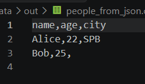
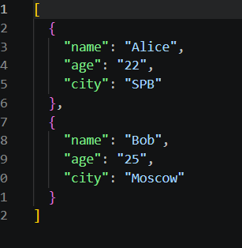
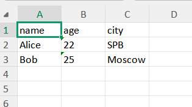
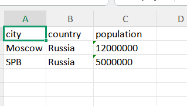

# ЛР5 — JSON и конвертации (JSON↔CSV, CSV→XLSX): Техническое задание
---
## Задание A — JSON ↔ CSV

```python
def json_to_csv(json_path: str, csv_path: str) -> None:
    """Преобразует JSON-файл в CSV. Порядок колонок — как в первом объекте."""
    p_in, p_out = Path(json_path), Path(csv_path)
    
    if not p_in.is_file():
        raise FileNotFoundError(f"Файл не найден: {json_path}")

    with p_in.open("r", encoding="utf-8") as f:
        try:
            data = json.load(f)
        except json.JSONDecodeError:
            raise ValueError("Неверный формат JSON")

    if not isinstance(data, list) or not data:
        raise ValueError("Пустой JSON или неподдерживаемая структура (ожидался список)")
    if not all(isinstance(item, dict) for item in data):
        raise ValueError("Все элементы списка JSON должны быть словарями")

    headers = data[0].keys()

    p_out.parent.mkdir(parents=True, exist_ok=True)
    with p_out.open("w", encoding="utf-8", newline="") as f:
        writer = csv.DictWriter(f, fieldnames=headers, restval="")
        writer.writeheader()
        writer.writerows(data)
```
```python
def csv_to_json(csv_path: str, json_path: str) -> None:
    """Преобразует CSV в JSON. Заголовок обязателен."""
    p_in, p_out = Path(csv_path), Path(json_path)
    
    if not p_in.is_file():
        raise FileNotFoundError(f"Файл не найден: {csv_path}")

    with p_in.open("r", encoding="utf-8", newline="") as f:
        reader = csv.DictReader(f)
        if not reader.fieldnames:
            raise ValueError("В CSV файле отсутствует заголовок")
        data = list(reader)

    if not data:
        raise ValueError("CSV файл пуст (нет данных)")

    p_out.parent.mkdir(parents=True, exist_ok=True)
    with p_out.open("w", encoding="utf-8") as f:
        json.dump(data, f, ensure_ascii=False, indent=2)
```
Этот модуль реализует двустороннюю конвертацию между форматами JSON и CSV, используя только стандартные библиотеки Python (json, csv, pathlib). Функция json_to_csv принимает список словарей, берет названия колонок из первого объекта и записывает данные в CSV-файл, автоматически заполняя отсутствующие ключи пустыми строками с помощью csv.DictWriter. Функция csv_to_json читает CSV-файл с обязательным заголовком, превращает каждую строку в словарь (где все значения остаются строками) и сохраняет результат в красиво отформатированный JSON-файл (indent=2). Oбе функции строго проверяют наличие файлов и корректность их структуры, выбрасывая FileNotFoundError или ValueError в случае ошибок, и автоматически создают недостающие родительские папки перед записью результатов.

---

## Задание B — CSV → XLSX

```python 
def csv_to_xlsx(csv_path: str, xlsx_path: str) -> None:
    """Конвертирует CSV в XLSX с автошириной колонок (мин. 8 символов)."""
    p_in, p_out = Path(csv_path), Path(xlsx_path)

    if not p_in.is_file():
        raise FileNotFoundError(f"Файл не найден: {csv_path}")

    with p_in.open("r", encoding="utf-8", newline="") as f:
        rows = list(csv.reader(f))

    if not rows or not rows[0]:
        raise ValueError("CSV файл пуст или не имеет заголовка")

    wb = Workbook()
    ws = wb.active
    ws.title = "Sheet1"

    for row in rows:
        ws.append(row)

    # Автоширина
    for col_idx, column in enumerate(ws.columns, start=1):
        max_length = max((len(str(cell.value)) for cell in column if cell.value), default=0)
        # Минимум 8 символов, плюс 2 для отступов
        adjusted_width = max(max_length + 2, 8)
        ws.column_dimensions[get_column_letter(col_idx)].width = adjusted_width

    p_out.parent.mkdir(parents=True, exist_ok=True)
    wb.save(p_out)
```
Эта функция конвертирует CSV-файл в формат Excel (XLSX) с помощью библиотеки openpyxl, предварительно проверяя наличие исходного файла и выбрасывая FileNotFoundError, если его нет. Она считывает данные из CSV и записывает их в новый Excel-лист под названием "Sheet1", выдавая ошибку ValueError, если исходный файл пуст или лишен строки заголовка. Затем функция автоматически настраивает ширину каждой колонки: она находит самое длинное значение в столбце, добавляет к нему 2 символа для отступов и гарантирует, что ширина не будет меньше 8 символов. В конце она создает все необходимые родительские папки по указанному пути и сохраняет готовый, красиво отформатированный Excel-файл на диск.

---

## Готовимся запускать...
#### в requirements.txt пишем openpyxl 

В файлик people.json пишем 

```python
[
  {"name": "Alice", "age": 22, "city": "SPB"},
  {"name": "Bob", "age": 25}
]
```
В файлик people.csv пишем 

```python
name,age,city
Alice,22,SPB
Bob,25,Moscow
```
В файлик cities.csv пишем

```pytnon
city,country,population
Moscow,Russia,12000000
SPB,Russia,5000000
```
--- 

#### Далее пишем 
```python
import sys
sys.path.insert(0, ".")

from src.lab05.json_csv import json_to_csv, csv_to_json
from src.lab05.csv_xlsx import csv_to_xlsx
import os

# Создаем папку out, если ее нет
os.makedirs("data/out", exist_ok=True)

# Выполняем конвертации
json_to_csv("data/samples/people.json", "data/out/people_from_json.csv")
csv_to_json("data/samples/people.csv", "data/out/people_from_csv.json")
csv_to_xlsx("data/samples/people.csv", "data/out/people.xlsx")
csv_to_xlsx("data/samples/cities.csv", "data/out/cities.xlsx")

print("Все файлы успешно созданы в data/out/!")
```
---

### В data/out появляются файлы 
- people_from_json.csv (результат JSON→CSV)
#

#
- people_from_csv.csv (результат CSV→JSON)
#

#
#### Как открыть папку в Windows
1. В левой панели VS Code (проводник), где вы видите ваш файл people.xlsx (в папке data -> out), нажмите на него правой кнопкой мыши.
2. В выпадающем меню выберите пункт «Reveal in File Explorer» (или «Показать в проводнике»).
3. Откроется обычное окно папки Windows. Вы увидите там ваш файл people.xlsx.
#
- people.xlsx (результат CSV→XLSX)
#

#
- cities.xlsx 
#



