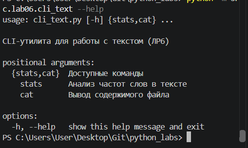
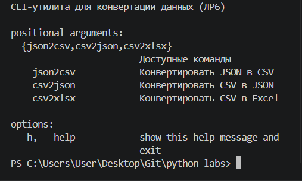
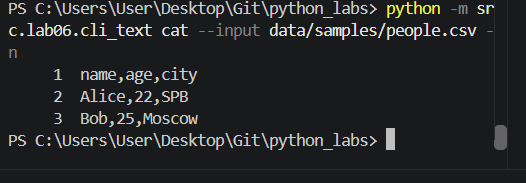
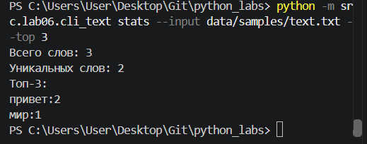

# ЛР6 — CLI‑утилиты с argparse (cat/grep‑lite + конвертеры): Техническое задание
---
## Задание A — Утилита для работы с текстом (cli_text.py)
```python
import argparse
import sys
from pathlib import Path

# Импорты из ЛР3 (предполагается, что функции лежат в src/lib/text.py)
from src.lib.text import normalize, tokenize, count_freq, top_n

def cmd_stats(args):
    """Анализ частот слов в тексте."""
    p_in = Path(args.input)
    if not p_in.is_file():
        # Выводим понятную ошибку и завершаем работу
        print(f"Ошибка: Файл '{args.input}' не найден.", file=sys.stderr)
        sys.exit(1)

    text = p_in.read_text(encoding="utf-8")
    tokens = tokenize(normalize(text))
    freq = count_freq(tokens)
    
    print(f"Всего слов: {len(tokens)}")
    print(f"Уникальных слов: {len(freq)}")
    print(f"Топ-{args.top}:")
    for word, count in top_n(freq, args.top):
        print(f"{word}:{count}")

def cmd_cat(args):
    """Вывод содержимого файла построчно."""
    p_in = Path(args.input)
    if not p_in.is_file():
        print(f"Ошибка: Файл '{args.input}' не найден.", file=sys.stderr)
        sys.exit(1)

    with p_in.open("r", encoding="utf-8") as f:
        for i, line in enumerate(f, start=1):
            if args.n:
                # Выравниваем номера строк по правому краю (ширина 6 символов)
                print(f"{i:6}\t{line}", end="")
            else:
                print(line, end="")

def main():
    parser = argparse.ArgumentParser(description="CLI-утилита для работы с текстом (ЛР6)")
    subparsers = parser.add_subparsers(dest="command", required=True, help="Доступные команды")

    # Подкоманда stats
    stats_parser = subparsers.add_parser("stats", help="Анализ частот слов в тексте")
    stats_parser.add_argument("--input", required=True, help="Путь к текстовому файлу")
    stats_parser.add_argument("--top", type=int, default=5, help="Количество топ-слов (по умолчанию 5)")
    stats_parser.set_defaults(func=cmd_stats)

    # Подкоманда cat
    cat_parser = subparsers.add_parser("cat", help="Вывод содержимого файла")
    cat_parser.add_argument("--input", required=True, help="Путь к файлу")
    cat_parser.add_argument("-n", action="store_true", help="Нумеровать строки")
    cat_parser.set_defaults(func=cmd_cat)

    args = parser.parse_args()
    # Вызываем функцию, привязанную к подкоманде
    args.func(args)
```
---
Этот модуль создает консольную утилиту с двумя подкомандами с помощью стандартного модуля argparse. Подкоманда cat читает файл и выводит его построчно, поддерживая флаг -n для нумерации строк (с выравниванием номеров по правому краю). Подкоманда stats использует функции из ЛР3 для нормализации, токенизации текста и подсчета частот, выводя общее количество слов, количество уникальных и топ-N самых частых слов (задается параметром --top). В случае отсутствия входного файла программа выводит понятную ошибку в stderr и завершает работу с кодом 1.

---

## Задание B — Утилита-конвертер (cli_convert.py)
```python
import argparse
import sys
from pathlib import Path

# Импорты из ЛР5
from src.lab05.json_csv import json_to_csv, csv_to_json
from src.lab05.csv_xlsx import csv_to_xlsx

def handle_convert(func, input_path, output_path):
    """Вспомогательная функция для вызова конвертеров и обработки ошибок."""
    try:
        func(input_path, output_path)
        print(f"Успешно: {input_path} -> {output_path}")
    except FileNotFoundError as e:
        print(f"Ошибка: {e}", file=sys.stderr)
        sys.exit(1)
    except ValueError as e:
        print(f"Ошибка данных: {e}", file=sys.stderr)
        sys.exit(1)
    except Exception as e:
        print(f"Непредвиденная ошибка: {e}", file=sys.stderr)
        sys.exit(1)

def main():
    parser = argparse.ArgumentParser(description="CLI-утилита для конвертации данных (ЛР6)")
    subparsers = parser.add_subparsers(dest="command", required=True, help="Доступные команды")

    # Фабрика для создания одинаковых подкоманд
    for cmd_name, cmd_help, target_func in [
        ("json2csv", "Конвертировать JSON в CSV", json_to_csv),
        ("csv2json", "Конвертировать CSV в JSON", csv_to_json),
        ("csv2xlsx", "Конвертировать CSV в Excel", csv_to_xlsx)
    ]:
        p = subparsers.add_parser(cmd_name, help=cmd_help)
        p.add_argument("--in", dest="input", required=True, help="Входной файл")
        p.add_argument("--out", dest="output", required=True, help="Выходной файл")
        # Привязываем функцию через lambda, чтобы передать target_func
        p.set_defaults(func=lambda args, f=target_func: handle_convert(f, args.input, args.output))

    args = parser.parse_args()
    args.func(args)
```
---
Этот модуль представляет собой CLI-обертку для функций конвертации, написанных в ЛР5. Он использует argparse для создания трех подкоманд: json2csv, csv2json и csv2xlsx. Каждая команда принимает обязательные аргументы --in (входной файл) и --out (выходной файл). Специальная вспомогательная функция перехватывает возможные ошибки (FileNotFoundError, ValueError), выводит их в понятном виде и завершает работу программы, а в случае успеха печатает зеленую галочку и пути файлов.

---
## Подготовка к запуску
Зависимости из ЛР5 остаются актуальными. Если вы еще не установили Excel-библиотеку, убедитесь, что в requirements.txt есть openpyxl.
Все команды выполняются из корня проекта через флаг -m (запуск как модуль).

Для проверки команды stats создайте файл data/samples/text.txt и напишите туда любой текст:
```python
Привет, мир, привет
```
---

### Выполняем команды в терминале
- Проверка справки (--help)
```python
python -m src.lab06.cli_text --help
python -m src.lab06.cli_convert --help
```
#

#

#
- Команда cat (вывод файла с нумерацией строк)
```python
python -m src.lab06.cli_text cat --input data/samples/people.csv -n
```
#

#
- Команда stats (анализ частот, топ-3)
```python
python -m src.lab06.cli_text stats --input data/samples/text.txt --top 3
```
#

#

- Конвертеры (JSON -> CSV, CSV -> JSON, CSV -> XLSX)
```python
python -m src.lab06.cli_convert json2csv --in data/samples/people.json --out data/out/people_cli.csv
python -m src.lab06.cli_convert csv2json --in data/samples/people.csv --out data/out/people_cli.json
python -m src.lab06.cli_convert csv2xlsx --in data/samples/people.csv --out data/out/people_cli.xlsx
```


### Результаты работы
После выполнения команд конвертации в папке data/out/ появляются файлы:
1. people_cli.csv - результат JSON→CSV
2. people_cli.json - результат CSV→JSON
3. people_cli.xlsx - результат CSV→XLSX
#



